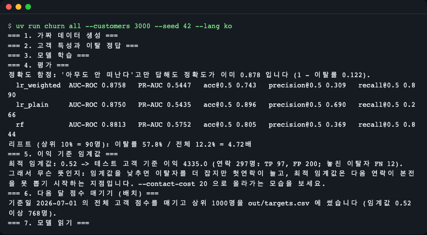
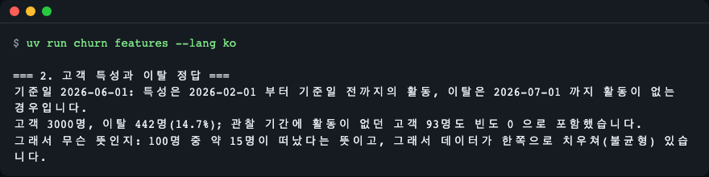
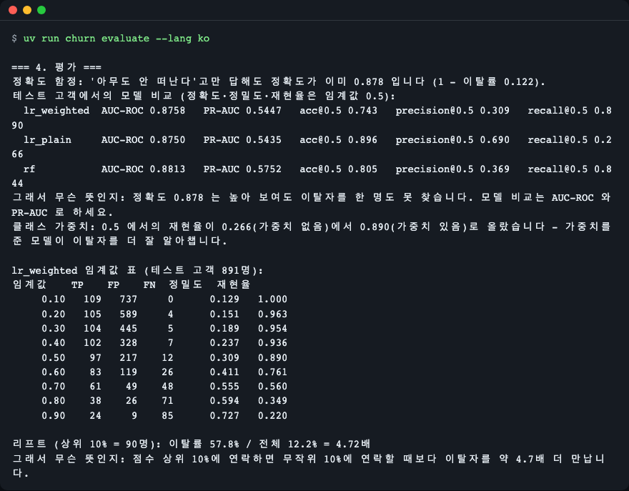
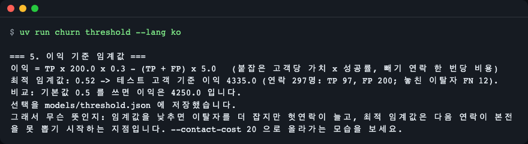
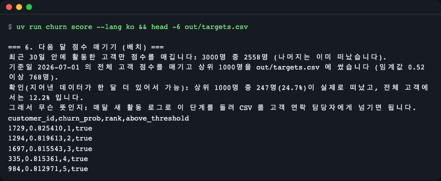
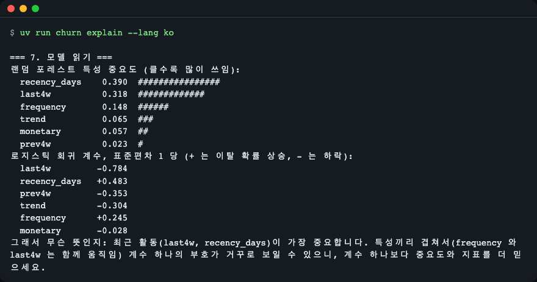
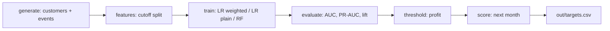

# ai-lab-pyspark-churn-scoring

[English](README.md) | **한국어**

PySpark 로 고객 활동 로그를 이탈 확률로 바꾸고, 불균형 데이터에서 정확도가 왜 속이는지 확인하고, 연락 기준(임계값)을 감이 아니라 돈으로 고르는 데모입니다. `uv run churn all` 한 줄이면 가짜 데이터에서 대상 고객 CSV 까지 노트북 한 대(`local[*]`, 클러스터·다운로드 없음)로 끝납니다. PySpark 시리즈 4/5편.


<sub>명령 하나로 보는 전체 흐름: 특성, 정확도 함정, AUC, 리프트, 이익 기준 임계값, 대상 목록.</sub>

| # | 레포 |
|---|---|
| 1 | ai-lab-pyspark-sales-aggregation |
| 2 | ai-lab-pyspark-price-regression |
| 3 | ai-lab-pyspark-demand-forecast |
| 4 | ai-lab-pyspark-churn-scoring (이 편) |
| 5 | ai-lab-pyspark-anomaly-detection |

## 한 줄 요약

끝까지 따라 하면 이벤트 로그를 고객당 한 줄(최근성·빈도·금액·4주 추세)로 요약하고, 떠날 고객을 예측하는 분류 모델을 학습하고, AUC·정밀도·재현율·리프트로 평가하고, 이익이 가장 큰 임계값을 골라 연락할 고객의 순위 목록을 만들 수 있습니다.

**이런 분께:** 파이썬 기초는 알고 PySpark 이름은 들어 봤지만 분류 모델은 아직 안 만들어 본 분, "정확도 88% 가 왜 좋은 소식이 아닌지" 설명해야 하는 분석가, 가져다 고쳐 쓸 작은 이탈 예측 파이프라인이 필요한 분.

## 왜 알아야 하나요?

한 주에 몇 명에게만 전화할 수 있는 가게 주인을 떠올려 보세요. 모두에게 걸면 비용이 크고, 아무에게도 안 걸면 단골을 잃습니다. 정말 필요한 질문은 "누가 떠날까?"가 아니라 "누구에게 걸어야 전화비가 아깝지 않을까?"입니다. 이탈 모델은 고객마다 확률을 줍니다. 임계값은 그 확률을 "건다 / 안 건다"로 바꿉니다. 연락 비용과 붙잡은 고객의 가치로 임계값을 고르면 모델이 의사결정이 됩니다.

여기 나오는 데이터는 고정 시드로 **지어낸 것**입니다. 숫자는 방법이 어떻게 동작하는지 보여 줄 뿐, 실제 사업 결과가 아닙니다.

## 30초 만에 실행하기

준비물:

- Python 3.12 이상과 [uv](https://docs.astral.sh/uv/) (`curl -LsSf https://astral.sh/uv/install.sh | sh`)
- Java 17 또는 21 (Spark 는 JVM 에서 돕니다). macOS: `brew install openjdk@21`. Debian/Ubuntu: `sudo apt-get install -y openjdk-21-jre-headless`

```bash
git clone https://github.com/LeeGyeongPil/ai-lab-pyspark-churn-scoring.git
cd ai-lab-pyspark-churn-scoring
uv run churn all --customers 3000 --seed 42
```

노트북에서 약 20초 걸립니다. 목(mock) 모드는 없습니다: 데이터는 내 컴퓨터에서 만들고 Spark 도 같은 프로세스 안에서 돕니다.

`JAVA_HOME` 이 없으면 흔한 위치(macOS 의 `java_home`, Homebrew `openjdk@21`/`@17`, `/usr/lib/jvm`)를 찾아봅니다. Java 가 다른 곳에 있으면 `JAVA_HOME` 을 직접 지정하세요.

출력 언어는 `--lang en|ko` 또는 환경변수 `CHURN_LANG` 으로 바꿉니다(순서: `--lang`, `CHURN_LANG`, `LC_ALL`/`LC_MESSAGES`/`LANG`, 모두 없으면 영어).

## 단계별로 따라 하기

`all` 은 아래 단계를 차례로 실행할 뿐입니다. 단계마다 따로 실행할 수도 있고, 각 단계는 앞 단계가 `data/`, `models/`, `out/` 에 저장한 것을 읽습니다.

### 1단계. 데이터와 고객당 한 줄 표 만들기

```bash
uv run churn generate --customers 3000 --seed 42
uv run churn features
```

`generate` 는 가짜 고객과 약 124,000건의 활동 이벤트를 씁니다. `features` 는 **기준일**(2026-06-01)로 시간을 자릅니다. 특성은 기준일 전 120일만, 정답(라벨)은 기준일 뒤 30일만 봅니다.


<sub>고객 3000명 중 14.7% 가 이탈. 관찰 기간에 활동이 없던 93명도 빈도 0 으로 포함했습니다.</sub>

무슨 뜻인가요: 여기서 "이탈"은 "기준일 뒤 30일 동안 활동 없음"입니다. 100명 중 약 15명이 떠났으니 클래스가 **불균형**입니다. 활동이 0인 고객도 일부러 남깁니다(고객 표에서 left join). 그런 고객이 가장 떠나기 쉬운 경우가 많기 때문입니다.

### 2단계. 모델 세 개 학습하기

```bash
uv run churn train
```

`lr_weighted`(클래스 가중치 있는 로지스틱 회귀), `lr_plain`(가중치 없음), `rf`(랜덤 포레스트, 나무 50개)가 만들어집니다. 고객 id 해시로 70/30 학습·테스트를 나누므로 같은 고객은 항상 같은 쪽에 있습니다.

### 3단계. 평가하기: 정확도 함정

```bash
uv run churn evaluate
```


<sub>"아무도 안 떠난다"만 답해도 정확도 0.878. 정확도로 가장 좋아 보이는 모델이 이탈자를 가장 적게 찾습니다.</sub>

무슨 뜻인가요:

- "아무도 안 떠난다"고만 답해도 정확도가 0.878 이고 이탈자는 한 명도 못 찾습니다. 이 경우 정확도만으로는 부족합니다.
- `lr_plain` 은 정확도가 가장 높지만(0.896) 재현율이 0.266 입니다: 이탈자 대부분을 놓칩니다. 클래스 가중치를 주면 0.5 에서 재현율이 0.890 으로 오르고, 대신 정밀도는 0.309 로 낮아집니다.
- AUC-ROC 와 PR-AUC 는 임계값에 따라 달라지지 않으므로 모델 비교에 씁니다.
- 상위 10% **리프트**: 점수가 가장 높은 90명의 이탈률은 57.8%, 전체는 12.2% 로 무작위로 거는 것보다 4.72배 좋습니다.

### 4단계. 돈으로 임계값 고르기

```bash
uv run churn threshold
```


<sub>최적 임계값 0.52 는 테스트 고객에서 이익 4335, 기본값 0.5 는 4250.</sub>

공식은 `이익 = TP x 가치 x 성공률 - (TP + FP) x 연락비` 입니다. 기본값은 가치 200, 성공률 0.3, 연락비 5 입니다. 연락비를 올려 보세요:

```bash
uv run churn threshold --contact-cost 20
```

최적 임계값이 0.70 으로 올라가고(이익 1460), 헛연락 한 번이 더 비싸졌기 때문입니다. 기본 0.5 를 쓰면 오히려 손해(-460)입니다. 선택은 `models/threshold.json` 에 저장됩니다. 이 명령은 파일을 덮어쓰므로, 5단계 전에 `uv run churn threshold` 를 다시 실행해 기본값 0.52 로 되돌리세요.

### 5단계. 다음 달 점수 매기고 대상 목록 쓰기

```bash
uv run churn score
```


<sub>최근 30일 안에 활동한 고객만 점수를 매기고, 상위 1000명을 `out/targets.csv` 에 씁니다.</sub>

`out/targets.csv` 의 열은 `customer_id,churn_prob,rank,above_threshold` 이고 확률이 높은 순입니다. 가짜 데이터가 한 달 더 있어서 스스로 확인할 수 있습니다: 상위 1000명 중 247명(24.7%)이 실제로 떠났고, 전체에서는 12.2% 입니다.

### 6단계. 모델 속 들여다보기

```bash
uv run churn explain
```


<sub>최근 활동(`last4w`, `recency_days`)이 가장 중요합니다.</sub>

특성끼리 겹치므로(`frequency` 와 `last4w` 는 같이 움직임) 계수 하나의 부호가 거꾸로 보일 수 있습니다. 계수 하나보다 중요도와 지표를 더 믿으세요.

## 어떻게 동작하나요?



1. `generate` 는 고정 시드로 이벤트를 만듭니다. 서서히 줄다 떠나는 고객, 갑자기 멈추는 고객, 쉬었다 돌아오는 고객이 섞여 있습니다(일부러 넣은 잡음).
2. `features` 는 입력은 기준일 전만, 정답은 기준일 뒤만 봐서 미래 정보가 학습에 새지 않습니다.
3. `train` 은 Spark ML 파이프라인 세 개를 학습해 저장합니다.
4. `evaluate` 는 임계값과 무관한 지표와 임계값 기준 지표로 모델을 비교합니다.
5. `threshold` 는 0.05~0.95 를 훑어 이익이 가장 큰 값을 찾습니다.
6. `score` 는 저장한 모델로 더 뒤의 기준일 고객에 점수를 매기고 순위 CSV 를 씁니다.

## 코드 둘러보기

| 파일 | 하는 일 |
|---|---|
| [`src/churn_scoring/features.py`](src/churn_scoring/features.py) | 기준일 분할, RFM + 추세 특성, 라벨, 클래스 가중치 |
| [`src/churn_scoring/threshold.py`](src/churn_scoring/threshold.py) | 이익 공식과 임계값 탐색 |
| [`src/churn_scoring/train.py`](src/churn_scoring/train.py) | Spark ML 파이프라인 세 개와 학습/테스트 분할 |
| [`src/churn_scoring/evaluate.py`](src/churn_scoring/evaluate.py) | AUC, 혼동 행렬, 정밀도, 재현율, 리프트 |
| [`src/churn_scoring/messages_ko.py`](src/churn_scoring/messages_ko.py) | 한국어 문구 전부(영어 짝은 `messages_en.py`) |

**1. 누수 없음.** 기준일 전 이벤트만 특성이 됩니다:

```python
cut = F.lit(cutoff.isoformat()).cast("date")
return events.where((F.col("event_date") < cut) & (F.col("event_date") >= F.date_sub(cut, obs_days)))
```

**2. 클래스 가중치.** 행마다 `n / (2 * 클래스 크기)` 를 주어 두 클래스가 똑같이 반영됩니다:

```python
w_pos = n / (2.0 * max(n_pos, 1))
w_neg = n / (2.0 * max(n_neg, 1))
```

**3. 이익.** 한 줄이 사업 규칙 전부입니다:

```python
return tp * save_value * success_rate - (tp + fp) * contact_cost
```

## 용어 사전

| 용어 | 뜻 |
|---|---|
| 이탈(churn) | 서비스 사용을 멈춘 고객(여기서는 기준일 뒤 30일 동안 활동 없음) |
| 최근성·빈도·금액 | 마지막 이벤트 후 지난 일수 / 이벤트 수 / 쓴 금액 합계 |
| 추세 | (최근 4주 이벤트 수 + 1) / (그 앞 4주 이벤트 수 + 1) |
| 기준일(cutoff) | "아는 것"(특성)과 "그 뒤에 일어난 일"(정답)을 가르는 날짜 |
| 데이터 누수 | 기준일 뒤 정보를 학습에 써서 결과가 실제보다 좋아 보이는 것 |
| 불균형 데이터 | 한쪽 클래스가 훨씬 드문 데이터(이탈 15%) |
| 클래스 가중치 | 학습 때 드문 클래스에 더 주는 중요도 |
| AUC-ROC | 무작위 이탈자가 무작위 비이탈자보다 높은 점수를 받을 확률(0.5 = 동전 던지기, 1 = 완벽) |
| PR-AUC | 정밀도-재현율 곡선 아래 면적. 양성이 드물 때 AUC-ROC 보다 더 잘 드러냄 |
| 정밀도 / 재현율 | 이탈이라고 한 고객 중 실제로 떠난 비율 / 떠난 고객 중 찾아낸 비율 |
| 리프트 | 점수 상위 집단의 이탈자가 같은 크기 무작위 집단보다 몇 배 많은지 |
| 임계값 | 이 확률 이상이면 고객에게 연락하는 기준 |

## 직접 바꿔 보기

1. **연락비** — `uv run churn threshold --contact-cost 20` → 최적 임계값이 오릅니다(0.52 → 0.70) → "최적 임계값" 줄을 비교하세요.
2. **고객 수나 시드** — `uv run churn all --customers 10000 --seed 7` → 지표가 달라지지만(시드 7·고객 10000명: AUC-ROC 약 0.82, 리프트 3.98배, 최적 임계값 0.40) 이야기는 같습니다 → AUC·리프트·"최적 임계값" 줄을 비교하세요.
3. **점수에 다른 모델** — `uv run churn score --model rf` → 상위 1000명 목록이 달라집니다(실제 이탈 247명 대신 243명) → "확인" 줄을 보세요.

## 자주 겪는 문제

| 증상 | 원인 | 해결 |
|---|---|---|
| Java 를 찾지 못했다는 메시지, 또는 `Java gateway process exited` | Spark 에 Java 17 또는 21 이 필요함 | 위 안내대로 설치하고 `JAVA_HOME` 지정 |
| 임시 폴더에 쓸 수 없다는 오류 | 시스템 임시 폴더가 막혀 있음 | `CHURN_TMP_DIR` 을 쓸 수 있는 폴더로 지정(기본 `./.spark-tmp`) |
| `Picked up JAVA_TOOL_OPTIONS`, `NativeCodeLoader` 경고 | 정상적인 Spark/JVM 안내 | 무시하거나 `2>/dev/null` 을 붙임 |
| README 와 숫자가 조금 다름 | Spark·라이브러리 버전 차이 | 끝자리가 아니라 흐름을 비교 |

## 더 알아보기

- [Spark MLlib: 분류와 회귀](https://spark.apache.org/docs/latest/ml-classification-regression.html)
- [BinaryClassificationEvaluator](https://spark.apache.org/docs/latest/api/python/reference/api/pyspark.ml.evaluation.BinaryClassificationEvaluator.html)
- [Spark 4.3.0 릴리스 노트](https://spark.apache.org/releases/spark-release-4-3-0.html)
- 데이터와 구성이 다른 공개 이탈 예제: [databricks-industry-solutions/churn](https://github.com/databricks-industry-solutions/churn)

## 라이선스

MIT — [LICENSE](LICENSE). 모든 데이터는 실행할 때 만든 가짜 데이터입니다.
