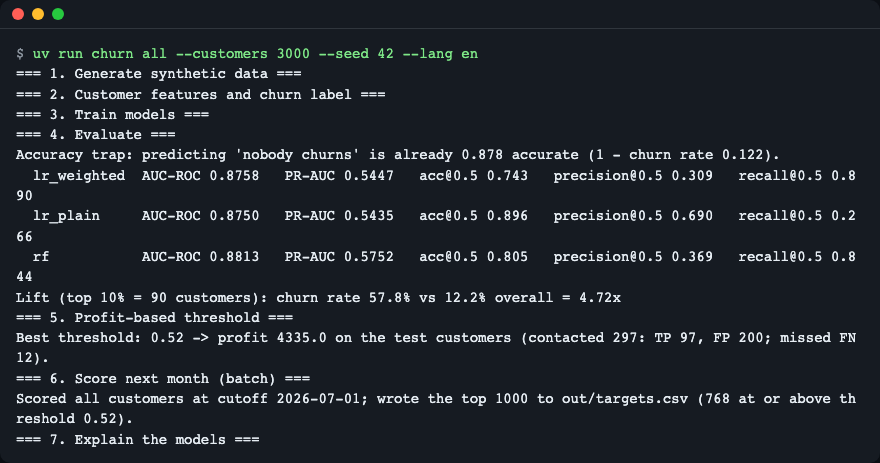
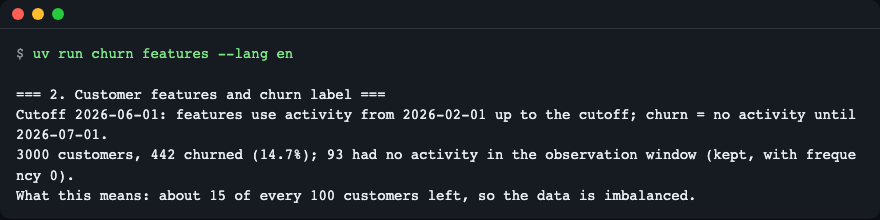
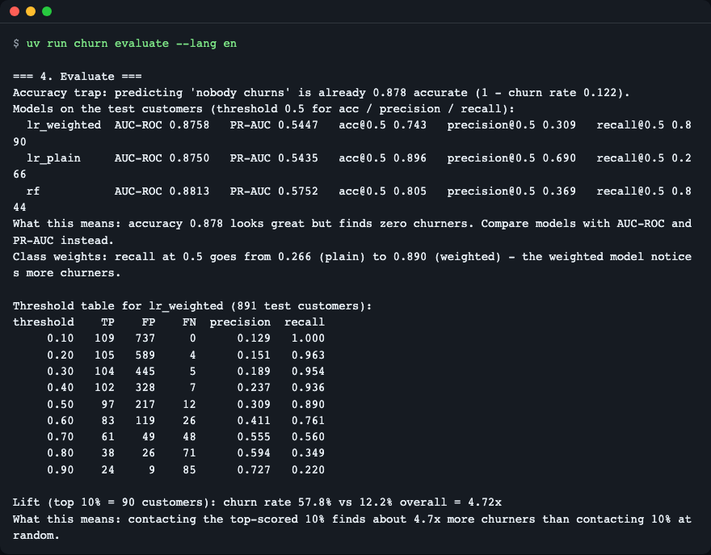
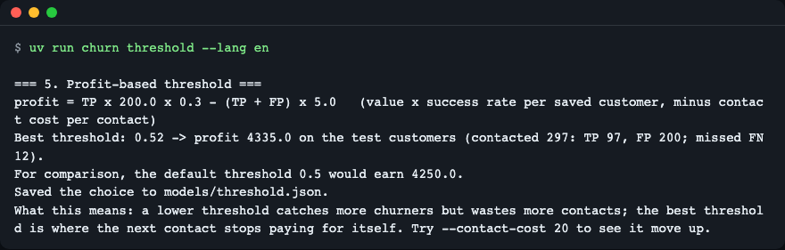
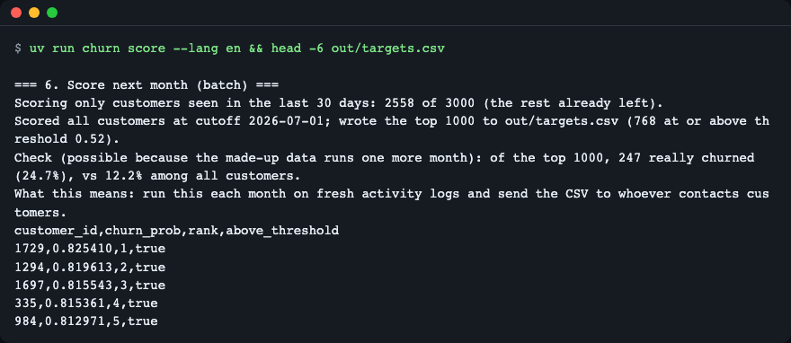
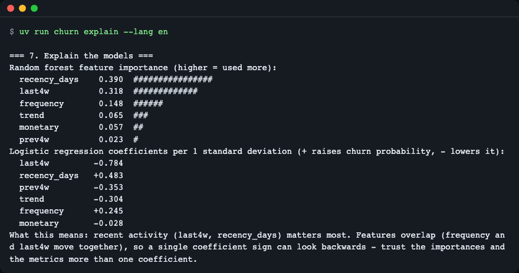
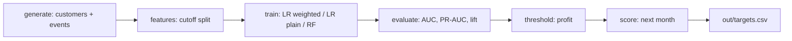

# ai-lab-pyspark-churn-scoring

**English** | [한국어](README.ko.md)

Turn customer activity logs into churn probabilities with PySpark, see why accuracy misleads on imbalanced data, and pick a contact threshold from money instead of guessing. Run `uv run churn all` and it goes from made-up data to a target-customer CSV on one laptop (`local[*]`, no cluster, no download). PySpark series, part 4 of 5.


<sub>The whole pipeline in one command: features, the accuracy trap, AUC, lift, the profit-based threshold and the target list.</sub>

| # | Repo |
|---|---|
| 1 | ai-lab-pyspark-sales-aggregation |
| 2 | ai-lab-pyspark-price-regression |
| 3 | ai-lab-pyspark-demand-forecast |
| 4 | ai-lab-pyspark-churn-scoring (this one) |
| 5 | ai-lab-pyspark-anomaly-detection |

## In one line

Follow it to the end and you can summarise an event log into one row per customer (recency, frequency, monetary value, 4-week trend), train a classifier that predicts who will leave, judge it with AUC, precision, recall and lift, choose the most profitable threshold, and write a ranked list of customers to contact.

**Good for:** people who know basic Python and have heard of PySpark but have not yet built a classifier on it; analysts who need to explain "why 88% accuracy is not good news"; anyone who wants a small, runnable churn pipeline to adapt.

## Why this matters

Imagine a shop owner who can phone only a few customers a week. Calling everyone is expensive, calling nobody loses regulars. The useful question is not "who will leave?" but "whom should I call so the calls pay for themselves?". A churn model gives each customer a probability. A threshold turns that probability into "call / don't call". Choosing the threshold from call cost and the value of a saved customer is what turns a model into a decision.

All data here is **made up** with a fixed seed. The numbers show how the method works, not real business results.

## Run it in 30 seconds

Prerequisites:

- Python 3.12 or newer and [uv](https://docs.astral.sh/uv/) (`curl -LsSf https://astral.sh/uv/install.sh | sh`)
- Java 17 or 21 (Spark runs on the JVM). macOS: `brew install openjdk@21`. Debian/Ubuntu: `sudo apt-get install -y openjdk-21-jre-headless`

```bash
git clone https://github.com/LeeGyeongPil/ai-lab-pyspark-churn-scoring.git
cd ai-lab-pyspark-churn-scoring
uv run churn all --customers 3000 --seed 42
```

It takes about 20 seconds on a laptop. There is no mock mode: the data is generated locally, and Spark runs in-process.

If `JAVA_HOME` is not set, the tool looks in the usual places (`java_home` on macOS, Homebrew `openjdk@21`/`@17`, `/usr/lib/jvm`). Set `JAVA_HOME` yourself if Java is somewhere else.

To switch the output language use `--lang en|ko` or the `CHURN_LANG` environment variable (order: `--lang`, then `CHURN_LANG`, then `LC_ALL`/`LC_MESSAGES`/`LANG`, otherwise English).

## Step by step

`all` just runs the steps below one after another. You can also run each step on its own; each reads what the previous one saved in `data/`, `models/` and `out/`.

### Step 1. Make the data and the one-row-per-customer table

```bash
uv run churn generate --customers 3000 --seed 42
uv run churn features
```

`generate` writes fake customers and about 124,000 activity events. `features` cuts time at a **cutoff date** (2026-06-01). Features only use the 120 days before it; the label only uses the 30 days after it.


<sub>3000 customers, 14.7% churned. 93 customers had no activity in the window and are kept with frequency 0.</sub>

What it means: "churn" here is "no activity for 30 days after the cutoff". About 15 of every 100 customers left, so the classes are **imbalanced**. Customers with zero activity are kept on purpose (a left join from the customer table), because they are often the likeliest to leave.

### Step 2. Train three models

```bash
uv run churn train
```

You get `lr_weighted` (logistic regression with class weights), `lr_plain` (same, without weights) and `rf` (random forest, 50 trees). Customers are split 70/30 into train and test by a hash of the customer id, so a customer is always on the same side.

### Step 3. Evaluate: the accuracy trap

```bash
uv run churn evaluate
```


<sub>"Nobody churns" is 0.878 accurate. The model that looks best on accuracy finds the fewest churners.</sub>

What it means:

- Answering "nobody churns" already scores accuracy 0.878 and finds zero churners. Accuracy alone is not enough here.
- `lr_plain` has the highest accuracy (0.896) but recall 0.266: it misses most churners. Class weights lift recall at 0.5 to 0.890, at the price of lower precision (0.309).
- AUC-ROC and PR-AUC do not depend on a threshold, so use them to compare models.
- **Lift** at the top 10%: the 90 highest-scored customers churn at 57.8% against 12.2% overall, 4.72 times better than calling at random.

### Step 4. Pick the threshold from money

```bash
uv run churn threshold
```


<sub>Best threshold 0.52 earns 4335 on the test customers; the default 0.5 earns 4250.</sub>

The formula is `profit = TP x value x success rate - (TP + FP) x contact cost`. The defaults are save value 200, success rate 0.3 and contact cost 5. Try a higher cost:

```bash
uv run churn threshold --contact-cost 20
```

The best threshold moves up to 0.70 (profit 1460), because each wasted call now costs more. At the default 0.5 you would lose money (-460). The choice is saved in `models/threshold.json`. This overwrites the file, so run `uv run churn threshold` again to restore the default 0.52 before Step 5.

### Step 5. Score a new month and write the target list

```bash
uv run churn score
```


<sub>Only customers active in the last 30 days are scored; the top 1000 go to `out/targets.csv`.</sub>

`out/targets.csv` has the columns `customer_id,churn_prob,rank,above_threshold`, highest probability first. Because the made-up data runs one more month, the tool can check itself: of the top 1000, 247 (24.7%) really churned, against 12.2% overall.

### Step 6. Look inside the models

```bash
uv run churn explain
```


<sub>Recent activity (`last4w`, `recency_days`) matters most.</sub>

Features overlap (`frequency` and `last4w` move together), so one coefficient's sign can look backwards. Trust the importances and the metrics over a single coefficient.

## How it works



1. `generate` makes events from a fixed seed, some customers fade out slowly, some stop suddenly, some pause and return (noise on purpose).
2. `features` looks only before the cutoff for inputs and only after it for the answer, so nothing from the future leaks into training.
3. `train` fits three Spark ML pipelines and saves them.
4. `evaluate` compares them with threshold-free and threshold-based metrics.
5. `threshold` searches 0.05 to 0.95 for the highest profit.
6. `score` loads the saved model, scores a later cutoff and writes the ranked CSV.

## Code tour

| File | What it does |
|---|---|
| [`src/churn_scoring/features.py`](src/churn_scoring/features.py) | Cutoff split, RFM + trend features, label, class weights |
| [`src/churn_scoring/threshold.py`](src/churn_scoring/threshold.py) | Profit formula and threshold search |
| [`src/churn_scoring/train.py`](src/churn_scoring/train.py) | The three Spark ML pipelines and the train/test split |
| [`src/churn_scoring/evaluate.py`](src/churn_scoring/evaluate.py) | AUC, confusion matrix, precision, recall, lift |
| [`src/churn_scoring/messages_en.py`](src/churn_scoring/messages_en.py) | All English text (the Korean twin is `messages_ko.py`) |

**1. No leakage.** Only events strictly before the cutoff become features:

```python
cut = F.lit(cutoff.isoformat()).cast("date")
return events.where((F.col("event_date") < cut) & (F.col("event_date") >= F.date_sub(cut, obs_days)))
```

**2. Class weights.** Each row gets `n / (2 * class_size)`, so both classes count equally:

```python
w_pos = n / (2.0 * max(n_pos, 1))
w_neg = n / (2.0 * max(n_neg, 1))
```

**3. Profit.** One line is the whole business rule:

```python
return tp * save_value * success_rate - (tp + fp) * contact_cost
```

## Glossary

| Term | Meaning |
|---|---|
| Churn | A customer who stops using the service (here: no activity for 30 days after the cutoff) |
| Recency / Frequency / Monetary | Days since the last event / number of events / total amount spent |
| Trend | (events in last 4 weeks + 1) / (events in the 4 weeks before + 1) |
| Cutoff | The date that separates "what we knew" (features) from "what happened next" (label) |
| Data leakage | Using information from after the cutoff in training, which makes results look better than they are |
| Imbalanced data | One class is much rarer than the other (15% churn) |
| Class weight | Extra importance given to the rare class during training |
| AUC-ROC | Chance that a random churner is scored above a random non-churner (0.5 = coin flip, 1 = perfect) |
| PR-AUC | Area under the precision-recall curve; more telling than AUC-ROC when the positive class is rare |
| Precision / Recall | Of those we flag, how many really leave / of those who leave, how many we flag |
| Lift | How many times more churners the top-scored group has than a random group of the same size |
| Threshold | Probability above which we contact a customer |

## Try changing things

1. **Contact cost** — `uv run churn threshold --contact-cost 20` → the best threshold rises (0.52 → 0.70) → compare the "Best threshold" line.
2. **More customers or another seed** — `uv run churn all --customers 10000 --seed 7` → metrics change (with seed 7 and 10000 customers: AUC-ROC about 0.82, lift 3.98x, best threshold 0.40) but the story stays → compare the AUC, lift and "Best threshold" lines.
3. **Another model for scoring** — `uv run churn score --model rf` → a different top-1000 list (243 really churned instead of 247) → check the "Check" line.

## Troubleshooting

| Symptom | Cause | Fix |
|---|---|---|
| Message that Java was not found, or `Java gateway process exited` | Spark needs Java 17 or 21 | Install it (see above) and set `JAVA_HOME` |
| Errors about a temp folder being not writable | The system temp dir is locked down | Set `CHURN_TMP_DIR` to a writable folder (default `./.spark-tmp`) |
| `Picked up JAVA_TOOL_OPTIONS` or `NativeCodeLoader` warnings | Normal Spark/JVM notices | Ignore them, or add `2>/dev/null` |
| Numbers differ slightly from this README | Different Spark or library versions | Compare the pattern, not the last digit |

## Learn more

- [Spark MLlib: classification and regression](https://spark.apache.org/docs/latest/ml-classification-regression.html)
- [BinaryClassificationEvaluator](https://spark.apache.org/docs/latest/api/python/reference/api/pyspark.ml.evaluation.BinaryClassificationEvaluator.html)
- [Spark 4.3.0 release notes](https://spark.apache.org/releases/spark-release-4-3-0.html)
- Other open churn examples, which use different data and setups: [databricks-industry-solutions/churn](https://github.com/databricks-industry-solutions/churn)

## License

MIT — see [LICENSE](LICENSE). All data is synthetic and generated at run time.
